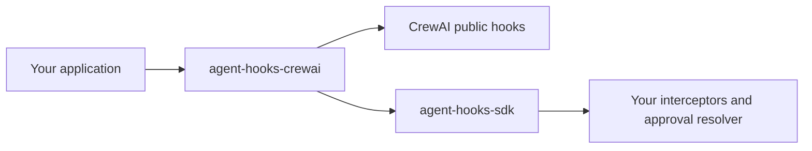

# agent-hooks-adapters

Small, independently packaged integrations between
[agent-hooks](https://github.com/responsibleai/agent-hooks) and agent frameworks.
Frameworks do not need to depend on agent-hooks or change their core.

**First adapter:** `agent-hooks-crewai` (local alpha; not published by this workspace).
Only CrewAI is implemented. Future LangGraph, Google ADK, and OpenAI Agents SDK
adapters should be separate packages, not dependencies of this one.

**Release status:** an upstream CrewAI/Chroma dependency audit is currently
blocked. See [the security notice](SECURITY.md#known-dependency-release-blocker);
working local examples are not a production security approval.



## Start here

Requires Python 3.11-3.13 and `uv`. Run from this directory:

```bash
uv sync --group dev
uv run --no-sync python -m examples.crewai.allowed
```

The examples require an **already running** Ollama on `localhost:11434` with
`qwen2.5:latest` installed. They never download a model, start a service, or fall
back to a remote provider. See [the example guide](examples/crewai/README.md).

| Example | What it demonstrates | Command |
|---|---|---|
| Allowed | A real model answer passes its policies | `uv run --no-sync python -m examples.crewai.allowed` |
| Blocked | A generated draft is blocked before normal release | `uv run --no-sync python -m examples.crewai.blocked` |
| Human approval | A person approves or rejects the actual generated draft | `uv run --no-sync python -m examples.crewai.human_approval` |
| Multiple agents | Researcher and editor have separate policy instances | `uv run --no-sync python -m examples.crewai.multi_agent` |

## Application API

Given your existing `crew`, `researcher`, and policy instances:

Configure agents with `respect_context_window=False` and `max_iter >= 2`, and
use text-output tasks. Automatic summarization and structured-output repair can
make model calls outside public hooks, so this alpha refuses those paths.

```python
from agent_hooks_crewai import AgentPolicy, CrewAIAdapter

adapter = CrewAIAdapter(
    crew,
    interceptors=[shared_policy],
    agent_policies=[AgentPolicy(researcher, (researcher_policy,))],
)
result = adapter.kickoff()
records = adapter.records
```

Shared policies run before the selected agent's policies. Bind policies to the
actual `Agent`, not a model-supplied role name. An adapter is single-use; create a
new one for the next run. Call **`adapter.kickoff()`**, not `crew.kickoff()`, to
enter the governed execution scope.

**Support is intentionally explicit:** synchronous sequential crews on the
pinned CrewAI release. The adapter rejects unsupported execution modes instead
of silently claiming coverage. It is not a sandbox and does not make arbitrary
tools or Python policies safe. Read [coverage and limitations](docs/coverage.md)
before using it for enforcement.

## Repository layout

```text
packages/crewai/        Installable adapter, typed source, unit/integration tests
examples/crewai/        Four runnable local-model examples
tests/                 Example e2e and dependency conformance checks
docs/                  Architecture, coverage, and actual example receipts
```

No empty framework scaffolds or shared runtime abstraction are included. Add
another package only when implementing another adapter.

## Develop

```bash
uv run --no-sync ruff check .
uv run --no-sync ruff format --check .
uv run --no-sync pyright
uv run --no-sync pytest -m 'not e2e'
LOCAL_MODEL_REQUIRED=1 uv run --no-sync pytest -m e2e
uv build --package agent-hooks-crewai
```

Default CI runs deterministic checks without downloading models. Local-model
tests are a separate required evidence tier; a skip is not a pass.

See [architecture](docs/architecture.md), [contributing](CONTRIBUTING.md), and
[validation evidence](docs/validation.md). Read the [security scope](SECURITY.md)
before deployment. Licensed under [MIT](LICENSE).
