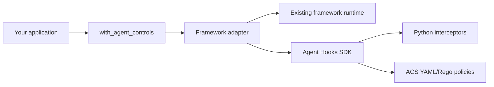

# Agent Control Adapters

Policy enforcement adapters for agent frameworks. Connect your existing workflow
to [Agent Hooks](https://github.com/responsibleai/agent-hooks) using Python
interceptors or [Agent Control Specification (ACS)](https://pypi.org/project/agent-control-spec/)
YAML/Rego policies, without modifying framework internals.

**Status:** alpha; adapter distributions are not yet published to PyPI.
Production release is blocked by upstream dependency advisories and incomplete
model/review acceptance. See [validation](docs/validation.md) for the evidence gaps.
Read the [security notice](SECURITY.md#known-dependency-release-blocker) before
deployment.

## What you get

- **One integration API:** `with_agent_controls` accepts your native framework
  runtime and returns a governed runner.
- **Two policy sources:** use Python interceptors or ACS YAML/Rego without
  changing the framework integration.
- **Shared and per-agent controls:** compose shared policies with additional
  policies bound to trusted, application-owned agent objects.
- **Fail-closed execution:** policy denials fail the governed run, and unsupported
  execution paths are rejected rather than silently treated as covered.
- **Auditable decisions:** inspect actual SDK records, bounded record retention,
  and host-owned trace correlation.
- **Independent packages:** install the adapter you need without pulling in
  unrelated frameworks.

## Get started

Requires **Python 3.11-3.13**. Choose a supported adapter for source installation,
framework configuration, and complete runnable examples:

| Framework | Adapter package | Controls | Execution | Documentation |
|---|---|---|---|---|
| CrewAI | `agent-hooks-crewai` | Agent Hooks or ACS | Sync | [Adapter guide](docs/crewai/README.md) / [Complete examples](docs/crewai/examples.md) |
| Google ADK | `agent-hooks-google-adk` | Agent Hooks or ACS | Async | [Adapter guide](docs/google-adk/README.md) |
| LangChain | `agent-hooks-langchain` | Agent Hooks or ACS | Native sync / async | [Adapter guide](docs/langchain/README.md) |
| LangGraph | `agent-hooks-langgraph` | Agent Hooks or ACS | Native sync / async | [Adapter guide](docs/langgraph/README.md) |

Each adapter has an explicit supported execution profile; review its guide and
[coverage](docs/coverage.md) before using it for enforcement. Use separate
dependency environments for the framework adapters. Their pinned dependency
closures are not compatible with an umbrella installation.

The shared `agent-hooks-adapters` package provides backend selection, policy
assignments, run requests/results, and common errors. See the
[shared API reference](docs/api.md) for contracts and compatibility aliases.
Distribution and Python import names retain their `agent-hooks` / `agent_hooks`
prefixes.

Python source packages live in [`python/packages/`](python/packages/), leaving
room for future language-specific implementations. The root workspace manages
core and CrewAI; other Python adapters keep independent locks and environments.

## Security boundaries

This is a governance integration, **not a sandbox**. Policies, tools, and
framework configuration are trusted application code. Direct calls outside
the governed runner are not protected, and completed model or tool effects
cannot be rolled back.

Use appropriate process/network isolation and a trusted approval service for
your application. Review the [security policy](SECURITY.md) and
[coverage and limitations](docs/coverage.md); working examples do not establish
production security approval.

## Documentation

| Guide | Contents |
|---|---|
| [Shared API](docs/api.md) | Factory, policy sources, per-agent bindings, results, and errors |
| [Portable contract](docs/portable-contract.md) | Language-independent boundaries and backend acceptance requirements |
| [CrewAI adapter](docs/crewai/README.md) | Installation, supported execution, hook mapping, and lifecycle |
| [CrewAI examples](docs/crewai/examples.md) | Complete applications, native-hook migration, and YAML/Rego assets |
| [Architecture](docs/architecture.md) | Shared runtime, native integration seams, ownership, and design decisions |
| [Coverage](docs/coverage.md) | Supported boundaries and enforcement limitations |
| [Security](SECURITY.md) | Trust model, reporting, and dependency release blockers |
| [Validation](docs/validation.md) | Test evidence and its scope |

## Contributing

See [CONTRIBUTING.md](CONTRIBUTING.md) for the locked development environment,
quality checks, and required local-model test tiers. Framework-specific guides
belong in `docs/<framework>/`; runnable code belongs in `examples/<framework>/`.

## License

[MIT](LICENSE).
