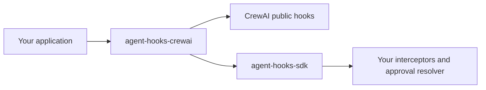

# agent-hooks-adapters

Small, independently packaged integrations between
[agent-hooks](https://github.com/responsibleai/agent-hooks) and agent frameworks.
Frameworks do not need to depend on agent-hooks or change their core.

**First adapter:** `agent-hooks-crewai` (local alpha; not published by this workspace).
Only CrewAI is implemented. Future LangGraph, Google ADK, and OpenAI Agents SDK
adapters should be separate packages, not dependencies of this one.

**Release status:** an upstream CrewAI/Chroma dependency audit is currently
blocked. See [the security notice](SECURITY.md#known-dependency-release-blocker);
working local examples are not a production security approval.



## Start here

Requires Python 3.11-3.13 and `uv`. Run from this directory:

```bash
uv sync --group dev
uv run --no-sync python -m examples.crewai.llm_hooks
```

The examples require an **already running** Ollama on `localhost:11434` with
`qwen2.5:latest` installed. They never download a model, start a service, or fall
back to a remote provider. See [the example guide](examples/crewai/README.md).

| Example | What it demonstrates | Command |
|---|---|---|
| [LLM hooks](examples/crewai/llm_hooks.py) | Sanitize a real model response using an SDK transform | `uv run --no-sync python -m examples.crewai.llm_hooks` |
| [Tool hooks](examples/crewai/tool_hooks.py) | Block a model-requested tool before execution | `uv run --no-sync python -m examples.crewai.tool_hooks` |
| [Human approval](examples/crewai/human_approval.py) | Approve or reject a model-requested message preview | `uv run --no-sync python -m examples.crewai.human_approval` |
| [Agent-scoped hooks](examples/crewai/multi_agent.py) | Researcher and editor have separate policy instances | `uv run --no-sync python -m examples.crewai.multi_agent` |

Each example is a complete, standalone file using CrewAI's built-in local-model
provider, policies, and explicit agent/crew setup. All use the shared
`with_agent_hooks(...).run(RunRequest(...))` API. Their scenarios replace
CrewAI's native LLM/tool-hook examples with SDK policies, not a new workflow
framework. See the [native-hook migration guide](examples/crewai/README.md).
Model provenance and detailed receipts are collected by the tests.

## Application API

Install the shared API and CrewAI backend with
`pip install 'agent-hooks-adapters[crewai]'`. Given your existing `crew`,
`researcher`, and framework-neutral policy instances:

Configure agents with `respect_context_window=False` and `max_iter >= 2`, and
use text-output tasks. Automatic summarization and structured-output repair can
make model calls outside public hooks, so this alpha refuses those paths.

```python
from agent_hooks_adapters import AgentPolicy, Backend, RunRequest, with_agent_hooks

adapter = with_agent_hooks(
    backend=Backend.CREWAI,
    runtime=crew,
    interceptors=[shared_policy],
    agents={"researcher": researcher},
    agent_policies=[AgentPolicy("researcher", (researcher_policy,))],
)
result = adapter.run(RunRequest(inputs={"question": "Explain unit tests."}))
output = result.output
records = result.records
```

Shared policies run before the selected agent's policies. Bind policies to the
trusted `agents` mapping, not a model-supplied role name or request field.
Application labels stay stable while each backend resolves actual native agent
objects; SDK identities are not replaced by those labels. An adapter is single-use;
create a new one for the next run. Call **`adapter.run()`**, not `crew.kickoff()`,
to enter the governed execution scope. Governance denial raises the shared
`AdapterBlocked` error instead of returning a successful result.

Only the CrewAI backend is implemented in this change. An OpenAI Agents backend
can implement the same request/result, policy assignment and error contracts,
but native workflow setup and hook coverage must be verified separately.
`Backend.CREWAI` is currently the only enum member; raw strings and invalid
backend selectors are rejected. The existing
`agent_hooks_crewai.CrewAIAdapter.kickoff()` API remains compatible for callers
that need the native `CrewOutput`. `create_adapter` remains a compatible alias
of `with_agent_hooks`.

**Support is intentionally explicit:** synchronous sequential crews on the
pinned CrewAI release. The adapter rejects unsupported execution modes instead
of silently claiming coverage. It is not a sandbox and does not make arbitrary
tools or Python policies safe. Read [coverage and limitations](docs/coverage.md)
before using it for enforcement.

## Repository layout

```text
packages/crewai/        Installable adapter, typed source, unit/integration tests
packages/core/          Shared run/request/result API and backend selection
examples/crewai/        Four complete, standalone local-model examples
tests/                 Example e2e and dependency conformance checks
docs/                  Architecture, coverage, and actual example receipts
```

No empty framework scaffolds or shared runtime abstraction are included. Add
another package only when implementing another adapter.

## Develop

```bash
uv run --no-sync ruff check .
uv run --no-sync ruff format --check .
uv run --no-sync pyright
uv run --no-sync pytest -m 'not e2e'
LOCAL_MODEL_REQUIRED=1 uv run --no-sync pytest -m e2e
uv build --package agent-hooks-crewai
```

Default CI runs deterministic checks without downloading models. Local-model
tests are a separate required evidence tier; a skip is not a pass.

See [architecture](docs/architecture.md), [contributing](CONTRIBUTING.md), and
[validation evidence](docs/validation.md). Read the [security scope](SECURITY.md)
before deployment. Licensed under [MIT](LICENSE).
