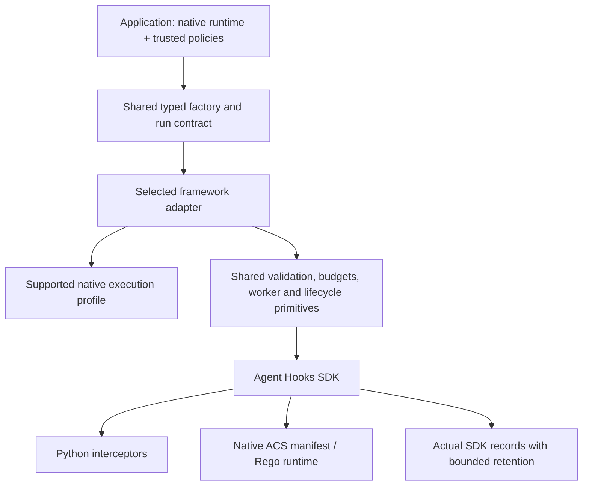

# Architecture

Native frameworks own agents, workflows, model clients, and tools. Adapters add
policy checks at supported native boundaries without translating the workflow
or introducing another policy evaluator.

## Layers

| Layer | Responsibility |
|---|---|
| `agent-control-adapters` | Backend selection, policy assignments, JSON contracts, errors, shared runtime primitives |
| Framework package | Admission, native seams, identity ownership, validated write-back and native cleanup |
| Agent Hooks SDK | Interceptor composition, decisions, approvals and audit records |
| ACS | Manifest loading and native policy evaluation |
| Application | Model/tool configuration, trusted policies, approval service, transport limits and process isolation |

The [root guide](../README.md#get-started) lists available adapters. Python
distributions live under `python/packages`; core/CrewAI share the root workspace,
while other adapters have independent locks. Framework dependencies do not
belong in core. The [portable contract](portable-contract.md) defines boundaries
for future implementations without promising identical native capabilities.

## Boundary flow

1. Validate the runtime, supported profile, policy source, run limits, and actual
   actor/tool ownership before governed execution.
2. Build trusted identity, session, trace, sequence, and budget metadata separately
   from detached, strict-JSON model/request/tool payloads.
3. Evaluate shared policies before actor-specific policies through the SDK.
4. Accept only supported, schema-valid transforms. Preserve executable arguments
   and immutable identity/registration fields where the native seam requires it.
5. On deny, timeout, malformed output, or overload, fail closed. Never feed blocked
   results into success parsing, caches, transforms, or tool execution.
6. Retain actual SDK records, report dropped records, and close owned work.
   Cleanup failure remains visible even after another failure.

Adapters are single-use. The shared sync/async contract does not make every
backend support both modes; choose the native mode documented by its guide.
CrewAI uses scoped synchronous hooks. MAF reuses native SDK middleware rather
than duplicating it. Other native profiles use shared session/budget primitives
and explicitly supported model/tool seams.

## Ownership and resource limits

Trusted application configuration binds stable labels to actual objects.
Role/name text, model payloads, and arbitrary request metadata do not authorize
an actor or overwrite a host envelope. Hook/function/schema permutations and
post-admission configuration changes must not bypass the binding.

Shared execution primitives bound worker admission, queued work, SDK record
retention, actor/session maps, model/tool budgets, and tool correlation. Complete
check-and-update operations are atomic; retries do not double-charge effects.
Host-owned trace propagation covers worker, SDK, budget, and cleanup contexts
where the native profile uses the shared session.

A timeout cancels/drains owned async work but cannot kill arbitrary synchronous
Python callbacks. Their capacity remains occupied until they exit. Native tools,
model clients, and custom policy code need application-level limits and process
isolation. A deadline is not permission to detach unfinished work.

## Design choices

| Decision | Benefit | Cost |
|---|---|---|
| Thin native adapters | Preserve framework UX and dependency direction | Each framework needs a verified supported profile |
| One typed contract | Reuse policies and failure handling | Native hook coverage still differs |
| Independent distributions | No unrelated frameworks in a selected installation | Separate locks/environments and dependency-first builds |
| Native ACS runtime | One policy semantics implementation | Upstream engine, resource, and context limits remain |
| Bounded owned state | Predictable concurrency and explicit cleanup | Nonpreemptible callbacks may exhaust capacity |

## Security and assurance

This is **governance, not a sandbox**. Policies/tools/configuration are trusted
code; direct runtime calls are outside the governed boundary. Completed actions
cannot be rolled back. ACS resources must remain immutable during a run;
lazy compilation can fail after earlier effects.

See [API](api.md), [coverage](coverage.md), [CrewAI architecture](crewai/architecture.md),
and [security](../SECURITY.md) for contracts and limits. [Validation](validation.md)
records missing final model/review acceptance and unresolved Chroma advisories.
No diagram or deterministic test result establishes production approval.
