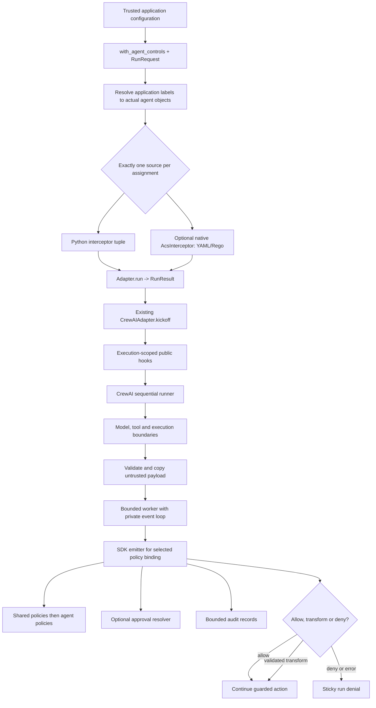
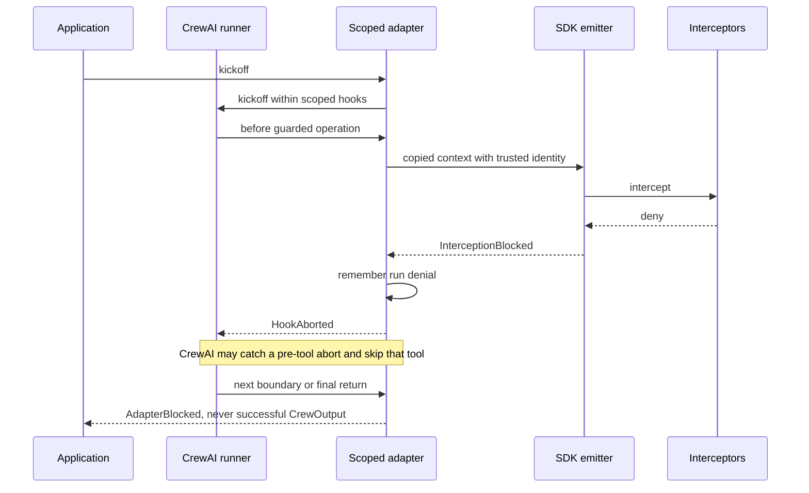

# CrewAI adapter architecture

## Why a separate adapter?

Applications opt into a small package depending on both CrewAI and agent-hooks.
Neither upstream framework imports the adapter. The initial release pins
`crewai==1.15.23` and `agent-hooks-sdk==0.1.0a5`: these are compatibility boundaries,
not a claim that every future patch is supported.

The shared `agent-hooks-adapters` package owns the small application-facing
request/result contract, logical policy assignments and explicit backend
selection. The CrewAI package owns translation and execution scope. The SDK owns verdict
composition, context identity, approval validation, and interception records.
Applications own policies, actual tools, model clients, and external side effects.
Optional YAML controls pin `agent-control-spec==0.4.0a4`, whose native interceptor
implements the same published SDK contract.

The initial profile also rejects automatic summarization and structured-output
repair. These can issue model calls outside the framework's public hooks. The
last model iteration is reserved and fails closed before an unhooked forced-final
request. This is intentionally narrower than wrapping or patching every model
client; the application receives a clear block rather than an ungoverned answer.

## Public API and ownership

`with_agent_controls` wraps an existing native runtime; `with_agent_hooks` and
`create_adapter` are exact compatibility aliases. No call registers global hooks
or changes the workflow.
The portable `Adapter` protocol exposes `run(RunRequest) -> RunResult`, bounded
SDK audit snapshots and explicit cleanup failure. `RunRequest` captures strict,
bounded JSON and returns detached copies; `RunResult` contains text and actual
records, never a success-shaped denial. The core imports no CrewAI types except
at its lazy composition-root dispatch, when the user explicitly selects that
installed backend with the public `Backend` enum. `Backend.CREWAI` is the only
implemented member. Raw strings and invalid selectors fail before backend loading,
instead of falling back.

Portable `AgentPolicy` names an application-owned label. The trusted `agents`
configuration resolves that label to one actual crew-owned Agent. Missing,
foreign, duplicate or ambiguous bindings are rejected; policies never select an
agent from request content or role text. Labels do not overwrite native SDK
agent UUIDs or other host metadata. The compiled controls are frozen into the
existing native object bindings. This keeps policy assignments reusable without
inventing a universal workflow or changing current event coverage.

`CrewAIAdapter` is single-use and binds one actual `Crew`. Its `run()` delegates
to the existing `kickoff()` method, so both entry points share admission, atomic
single-use state, scoped hooks, denial and cleanup. The `kickoff()` method
installs scoped hooks only for the run and always cleans up its worker. It does
not register process-wide callbacks. `AgentPolicy` binds interceptor instances to
an actual host-owned agent identity. Agents with the same role text do not share
policies unless the application deliberately gives them the same instance.
Native callers retain their original API and native result. Shared blocked and
cleanup error bases let portable callers catch enforcement failures without
depending on CrewAI, while the native abort type, causes and notes are preserved.

Crew execution-boundary events use shared policies. Model/tool events use shared
policies plus the matching agent's policies. Composition is sequential/run-all:
an approved escalation must not bypass a later mandatory policy.

Each binding has its own SDK session and sequence. A single worker owns mutable
SDK state. A bounded group of hook callers may wait for emission serialization
because CrewAI can execute multiple native tool calls in parallel even in a
sequential crew. Tool correlation includes host thread, agent and tool identity;
missing post events are not invented.

## Policy source composition

The core accepts exactly one shared source, `interceptors` or `policy_file`.
Each frozen logical `AgentPolicy` accepts the same alternatives; all four
shared/agent combinations work. Pure path validation captures an absolute
`Path` without resolving symlinks or lexical `..`. CrewAI runtime, deadline,
record-limit and every ownership/binding check complete before manifest I/O.

Only an explicit YAML source imports the fixed `agent_control_spec` module,
after checking its installed distribution version. A narrow local constructor
protocol bridges the released package's missing typing marker; there is no
dynamic plugin registry or user-selected import. Missing/incompatible installs
raise `ACSUnavailableError`; nested import errors and native constructor errors
remain visible.

ACS is already an SDK interceptor. Compile it into the existing native binding
tuples and keep one mapper, worker, emitter and error/record contract. Native
manifest parsing/inheritance is eager; Rego bundles compile lazily at their first
bound point. The files and any referenced network/credential configuration are
trusted application code. They must stay immutable; a constructor does not
snapshot every bundle or guarantee preflight readiness.

For eager deployment preflight, operators may use ACS's published
`ActivatedPolicy` API separately. Its native readiness/deadline behavior still
applies; a deadline is not proof abandoned native work stopped. Advanced services
can pass a prebuilt `AcsInterceptor` through `interceptors=` to reuse native
handles/cache or choose native limits, without creating a second host engine.

SDK registration receives no explicit name. Actual `verdicts[].name` stays
`None`, even if a native interceptor has a `name` property; `decided_by` remains
an actual positional index. Do not manufacture names or claim duplicate-name
rejection. Application-owned ordered configuration supplies source context.

Global YAML binds all eight points, while an agent file needs only model/tool
points. Unbound events deny, with shutdown recorded as audit-only. Manifest
approval settings are not a host resolver. The released Cedar engine requires
legacy `snapshot.envelope.agent.id`, so canonical SDK contexts fail closed;
the tested profile is YAML/Rego without translation.

## Denial is not a model response

Arbitrary callback exceptions are unsafe to rely on because CrewAI's hook
dispatcher catches them. The adapter converts mapping, engine and policy failure
into the framework's supported abort path. Public errors have a safe constant
message; audit records retain policy reasons. A denied post-model/tool value is
not replaced with a success-looking string.

Shutdown after denial is audit-only and must not replace the original exception.
If a failed worker cannot emit shutdown, a host diagnostic reports missing SDK
shutdown evidence rather than synthesizing a successful SDK record.

## Timeouts and cleanup

One worker owns a persistent event loop, one active emission, and bounded
admission. SDK timeouts govern cooperative async callbacks. The caller's
`emit_timeout` also bounds the wait for synchronous policies. Timeout poisons the
adapter: no additional work is admitted and late transforms cannot be applied.

Python cannot kill a running synchronous callback safely. Its slot remains
occupied until it exits. Cleanup joins for a finite interval and reports failure
if a noncooperative callback remains alive. A daemon thread in that case is a
**reported residual resource**, not a claimed successful cancellation. Use process
isolation for untrusted or potentially nonterminating policy code.

ACS adds inherited native limits, not another adapter worker. Its default
Rego deadline is 5,000 ms, influenced by `ACS_OPA_TIMEOUT_MS` and `ACS_REGO_V0`.
Native work can outlive a deadline in two pools of up to 32 abandoned workers
each, plus concurrent work; these are not global service quotas. Native process
allocation/parser failures may abort the process. Synchronous native execution
is not preempted by SDK `timeout`; host `emit_timeout` bounds waiting and cleanup
reporting. HTTPS inheritance during construction is outside both host deadlines;
annotators may use blocking network calls and named environment credentials.
The full serialized-snapshot default is 1,048,576 bytes. See the
[security scope](../SECURITY.md#acs-configuration-is-trusted-code).

The adapter does not own the model service or cancel Ollama's server-side
generation. Model clients, HTTP timeouts, tool deadlines and external side-effect
idempotency remain application responsibilities. No automatic replay is performed
by the adapter after a denial.

## Trust boundaries and threats

| Risk | Control | Remaining limitation |
|---|---|---|
| Prompt claims another agent's identity | Resolve policies from host-bound agent objects | Trusted application code can still alter its own objects |
| Payload overwrites session/policy metadata | Build metadata separately; copy and validate content | SDK/custom Python policies are trusted code, not sandboxed |
| Malformed transform or engine exception | Convert to abort; retain sticky deny | No rollback of an action already completed before its post hook |
| Concurrent policy/audit state races | Worker-owned state, bounded serialized emissions | Shared interceptor objects across adapters require application synchronization |
| Approval bypasses other policies | Run-all composition; SDK identity echo validation | Resolver must authenticate a real approver in production |
| Hung callback or approval | Finite deadlines; bounded residual work and explicit cleanup error | Noncooperative Python needs process isolation |
| Secret disclosure in diagnostics | No payload logging by adapter; safe public denial text | Policy reason strings and framework telemetry must also be designed safely |
| Later hooks undo enforcement | Narrow profile and explicit coverage documentation | Trusted hooks/plugins can bypass guarantees; not an authoritative kernel |
| Request chooses a policy file or remote inheritance | Policy sources belong to trusted application configuration | Native manifests can select HTTPS/HTTP effects and host credentials; no egress sandbox |
| Lazy compilation fails on a later agent/tool | Native error becomes actual denial at its first bound point | Prior effects are not rolled back; construction is not artifact preflight |

## Alternatives and future packages

Built-in integration would couple CrewAI to the SDK and was not the requested
deployment model. Global registration makes scope and cleanup harder. Monkey
patching could reach missing seams but would depend on private implementation.
The chosen public-hook wrapper keeps the dependency direction explicit and
rejects unsupported paths.

Future adapters belong in independently versioned `packages/langgraph`,
`packages/google-adk`, or `packages/openai-agents`. The approved portability
requirement introduces only shared data/protocol contracts and explicit
dispatch now; there is no generic runner, plugin system or workflow translator.
An OpenAI adapter is not implemented or advertised as interchangeable yet.
Each future backend must demonstrate the same request/result, blocked-error,
policy-ordering and identity-ownership contracts through its actual runner.
Differences in coverage, structured output and concurrency must fail explicitly,
not be hidden behind the common method name.

Separate Agent Hooks and ACS CrewAI mappers were rejected: ACS already implements
the SDK contract, and duplicating admission, identity mapping and cleanup would
increase the security surface. Translating YAML into synthetic Python policies
or adding a legacy Cedar envelope was also rejected in favor of native semantics
and an explicit limitation.

## Rollout

This workspace does not publish a release. Evaluate using harmless tools and
review audit records before real effects. Widen version pins only after the real
runner tests pass for each candidate version. Removing the wrapper/dependency is
the rollback, and also removes its enforcement. Partner sign-off is required
before a future upstream-facing merge; this task does not contact partners.

Mermaid source is included for GitHub rendering. Local rendered-image validation
is not claimed when a Mermaid renderer is unavailable.
