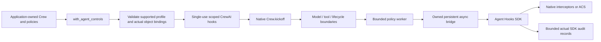

# CrewAI architecture

The adapter wraps one native Crew execution using scoped public hooks. CrewAI
keeps ownership of planning, model calls, tools, and output; the host owns policy
bindings, SDK contexts, admission, audit retention, and governance cleanup.

## Components



Bindings use actual agent and declared tool objects, not role strings. Stable
labels come from trusted application configuration. Model/request data cannot
choose identities, policy sources, sequence counters, or budget state.
The profile and hook gaps are listed in the [adapter guide](README.md).

## Request flow

```mermaid
sequenceDiagram
    participant App as Application
    participant Host as Adapter
    participant Crew as Native Crew
    participant SDK as SDK worker
    App->>Host: Construct with trusted Crew and policy bindings
    Host->>Host: Validate profile; capture actual owners
    App->>Host: run or kickoff, once
    Host->>SDK: startup and input
    Host->>Crew: Enter scoped native kickoff
    Crew->>Host: Before model/tool boundary
    Host->>SDK: Shared controls, then agent controls
    alt allow or valid transform
        SDK-->>Host: Actual result and records
        Host-->>Crew: Validated write-back
    else deny, timeout, error, malformed target
        Host->>Host: Retain sticky blocked state
        Host-->>App: AdapterBlocked, not successful output
    end
    Crew->>Host: Final native text
    Host->>SDK: output
    Host->>SDK: Audit-only shutdown
    Host->>Host: Cancel/drain/join owned governance work
    Host-->>App: Native or portable result, or cleanup error
```

The sequence shows contracts, not a recorded model run. Startup/input can deny
before native execution. Output denial may follow completed effects; no model or
tool action is rolled back. Shutdown cannot retroactively deny a completed action.

## Enforcement and ownership

- No global hooks or CrewAI monkey patches are installed. The governed scope ends
  on success, denial, cancellation, or exception.
- Shared and per-agent controls use SDK sequential/run-all composition. Approval
  cannot lift a final deny or skip later controls; SDK transform failure can
  short-circuit with a denial.
- A swallowed pre-tool/parallel-tool abort remains sticky, so native completion
  cannot convert a denied run into success.
- The actual admitted executor, configured iteration limit, and current counter
  are checked before model execution. Reserving the final iteration avoids
  CrewAI's unhooked forced-final call.
- Strict JSON copies separate untrusted inputs and arguments from trusted
  identity/context metadata. Invalid write-back fails closed.
- Each SDK crew/agent binding owns its session. Audit records are real SDK
  results; missing source names are not replaced with fabricated labels.
- Governance admission is bounded. A timeout does not free a still-running
  callback's slot. Async tasks are cancelled/drained, and loop/worker cleanup
  failure is surfaced rather than silently detached.

This is not a hard execution sandbox. Trusted synchronous policies and native
tools may outlive a caller timeout; process isolation is required for hard
termination. Model clients, tool effects, and directly called Crews remain
application responsibilities.

## ACS trust boundary

`policy_file` loads the pinned native `AcsInterceptor`; it does not introduce a
second parser or policy engine. Manifest loading happens at construction, while
referenced Rego bundles compile lazily at their first evaluation. A later policy
can therefore fail after earlier effects. Keep manifests/resources immutable
throughout a run.

Use host-owned local paths, trusted policy code, and a trusted approval resolver.
The loader's path/version checks do not apply to prebuilt interceptors. Native
engine limits and caching are not service-wide admission control. Review the
[ACS limits](../coverage.md#acs-policy-source), including the unsupported pinned
Cedar context, missing-binding denial, and approval configuration.

## Design choices

| Choice | Why | Tradeoff |
|---|---|---|
| Scoped native hooks | Preserve native runtime behavior and contain registration | Some internal calls are intentionally unsupported |
| Strict initial profile | Do not advertise invisible execution paths as governed | Reject useful but uncovered CrewAI features |
| Shared worker/bridge primitives | Reuse SDK orchestration and bounded lifecycle handling | Python callbacks cannot be forcibly killed |
| Native ACS evaluation | Keep policy semantics in the published runtime | Native engine/resource limitations remain |
| Sticky denial and explicit cleanup errors | No success-shaped failure or hidden unfinished work | Callers must handle governance and cleanup failures |

See [validation](../validation.md) for incomplete model/review evidence and
[security](../../SECURITY.md) for unresolved dependency advisories. This design
does not establish production approval.
