# Portable adapter contract

This document separates the language-independent integration requirements from
the current typed Python API. It is not a network protocol, universal workflow
format or claim that another language implementation already exists.

## Ownership and dependency direction

An application constructs the native runtime, tools and model clients. A
framework adapter depends on its native framework and a shared control contract;
the shared contract must not depend on framework types. Backend selection is
explicit and closed, with no discovery or fallback.

Python currently packages `agent-hooks-adapters` separately from its six
framework adapters. `with_agent_controls`, `with_agent_hooks` and `create_adapter`
are the exact same function. Future language implementations should preserve
the behavior below with their own native typed interfaces.

## Inputs, outputs and errors

| Surface | Required behavior |
|---|---|
| Control construction | Exactly one shared source: native interceptors or an ACS manifest; validate runtime/options/actual ownership before manifest I/O or worker creation |
| Actor assignments | Trusted application labels mapped to distinct, strongly retained native objects; shared policies run before actor policies |
| Builder result | Immutable runtime reference and detached read-only actor mapping; independently prove membership and complete coverage |
| Run input | Owned strict JSON snapshot; no model/request-selected identity, policy files, callbacks, runtime handles or execution configuration |
| Successful result | Normalized text, actual SDK records and explicit dropped-record count |
| Governance denial | A distinct blocked error, never success-shaped text, cached output or recoverable tool response |
| Cleanup failure | An inspectable distinct error; preserve an existing primary execution failure |
| Audit after failure | Actual bounded records remain available even without a result |

Python's `RunRequest` / `RunResult`, `AgentPolicy`, `NativeRuntime`, `Adapter`,
`AsyncAdapter` and common error classes implement these surfaces. See the
[shared API](api.md) for exact signatures. The five new Python adapters accept
only `{"prompt": text}` with 1-65,536 characters and non-whitespace content.
CrewAI retains its existing native input mapping. This declared difference is
not hidden by the common method name.

Strict JSON accepts only null, booleans, strings, arrays, string-keyed objects
and finite interoperable numbers. Integers are bounded to
`[-(2^53 - 1), 2^53 - 1]`; depth is at most 32, node count at most 10,000 and
UTF-8 text at most one MiB. Reject cycles, unsupported objects and invalid
Unicode. Preserve boolean/number and integer/float distinctions when comparing
immutable native fields.

## Capability and policy matrix

| Python backend | Native Python interceptors | ACS | Sync run | Caller-loop async run |
|---|---|---|---|---|
| CrewAI | Yes | Yes | Yes | No |
| Google ADK | Yes | Yes | Rejected before admission | Yes |
| LangChain | Yes | Yes | Native `invoke` | Native `ainvoke` |
| LangGraph | Yes | Yes | Native `invoke` | Native `ainvoke` |
| OpenAI Agents SDK | Yes | Yes | Rejected before admission | Yes |
| Microsoft Agent Framework | No additional adapter | Yes | Rejected before admission | Native middleware |

MAF accepts manifest files or nominally validated prebuilt native
`AcsInterceptor` objects, not arbitrary Python interceptors. It already provides
native Agent Hooks middleware. Other backends use the same integration path for
native interceptors and ACS; changing policy source does not translate workflows.

The eight named governance points are startup, input, pre/post model call,
pre/post tool call, output and shutdown. Backend guides must state which native
objects own them and which target fields can actually be transformed.
Shutdown is audit-only. A requested unsupported transform must block instead
of silently continuing with the original value.

## Single-use and lifecycle

```mermaid
stateDiagram-v2
    [*] --> Constructed
    Constructed --> Constructed: Unsupported sync entry on async-only backend
    Constructed --> Admitted: Atomic single-use admission
    Admitted --> Completed: Valid governed output
    Admitted --> Failed: Denial, error, deadline or cancellation
    Completed --> Closed: Bounded cleanup
    Failed --> Closed: Bounded cleanup; preserve primary failure
    Closed --> [*]
```

All admitted failures consume the instance, including invalid new-adapter
prompt input. Request-object construction errors occur before run admission.
No automatic retry, replay, resume or replacement success is provided.

Own and bound every worker, task, queue, session, audit buffer and correlation
map. Keep governance check/read/update operations atomic at the owning
abstraction. Cancellation does not release admission for work that has not
actually exited. Retain noncooperative work strongly and expose cleanup failure.
Do not close application-owned clients or loops.

The current Python shared runtime has one active SDK emission plus eight
waiting callers, a bounded audit cap, default 120-second async native deadline
and two-second drain. The new native profiles cap actors at 16, model calls at
10, tools per model output at one, pending correlations at 64 and non-audit
events at 256. Graph profiles additionally cap nodes at 16, edges at 64,
recursion at 30 and native concurrency at one. A future implementation must
declare equivalent bounds and prove their exact thresholds rather than merely
adding a caller-side timeout.

## Trust, transforms and correlation

SDK session/sequence, agent/framework identity, policy assignment, actor
membership and run budgets are host-owned. Untrusted model/tool content cannot
overwrite them. Labels are not proof of ownership; use actual native identity.
Model/tool correlations must reject wrong origin/destination, duplicate IDs,
cross-actor replay and missing lifecycle completion.

Transforms must be validated and consumed by the actual native action. Preserve
readonly roles, routing, tool IDs, usage/provider metadata and native output
shape. Reject unknown/coercing tool arguments before native schema parsing can
discard them. Post-tool denial never claims to undo completed effects.

Fixed safe native errors protect model-facing messages. Keep original policy
causes and actual audit evidence available to the application/operator.
Native ACS parsing/evaluation errors stay visible and fail closed; no synthetic
YAML evaluator or legacy context translation is permitted.

## Backend acceptance

A new backend or language port is accepted only with:

1. An installed real native namespace and explicit supported profile, not an
   enum placeholder.
2. Actual-runner proofs of consumed model/tool transforms and whole-run denial,
   including default native tool-error handling and zero pre-tool denied effects.
3. Unit and native integration coverage of input bounds, actual-object ownership,
   metadata protection, shared/actor order, engine failure and failed write-back.
4. Deterministic concurrent/cancellation/deadline tests proving exact-once
   accounting, bounded retention and close/join postconditions.
5. Native ACS/Rego tests when ACS is supported; declare genuine upstream
   conformance differences without editing expected vector assertions.
6. Whole owning-project static/type checks, independent builds, fresh noneditable
   wheel/import proof, locked dependency audit and no unrelated framework imports.
7. Complete runnable policy-source examples with real local-model receipts and
   copied-folder asset checks; mocks are restricted to unit transport boundaries.
8. Exact-snapshot architecture/code/security review and explicit authority before
   any publication or upstream-facing operation.

See [architecture](architecture.md), [coverage](coverage.md),
[validation](validation.md) and the selected backend guide for current evidence
and limitations. An unavailable, skipped or timed-out required check is missing
evidence, not an acceptance pass.
