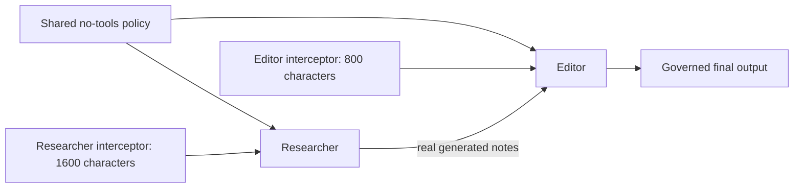
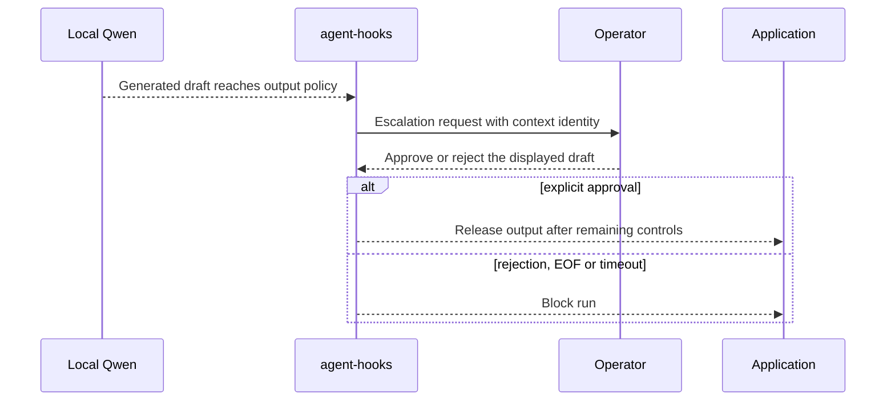

# Four real local-model examples

Run from the **repository root**, after `uv sync --group dev`.
Use an already installed/running Ollama with `qwen2.5:latest`:

```bash
curl --fail http://localhost:11434/api/tags
uv run --no-sync python -m examples.crewai.allowed
uv run --no-sync python -m examples.crewai.blocked
uv run --no-sync python -m examples.crewai.human_approval
uv run --no-sync python -m examples.crewai.multi_agent
```

No downloads or remote fallback occur. `LOCAL_MODEL` selects another installed
model; `LOCAL_MODEL_BASE_URL` accepts only a loopback `/v1` endpoint. HTTP proxies
and redirects are disabled. The transport closes when each example ends.
Telemetry/tracing is disabled for these demonstrations.
Agents explicitly disable automatic context summarization and use `max_iter=3`.
The adapter reserves the last iteration to prevent an unhooked forced-final
model call; these short tasks ordinarily finish after one governed request.

## What to expect

- **Allowed:** an actual local response passes a shared no-tools policy.
- **Blocked:** an actual local draft is denied at `post_model_call`; its text is
  not printed by the example or returned as a successful result.
- **Human approval:** the SDK emits a liftable deny at final output. The resolver
  displays the real draft with control characters escaped. Type `approve` within
  15 seconds to release it. Any other input, EOF, or timeout rejects it. SDK
  callback timeout is 20 seconds; total emission timeout is 30 seconds.
- **Multiple agents:** the researcher produces notes; the editor consumes them.
  The researcher has a 1,600-character response limit and the editor has an
  800-character limit, represented by **different interceptor instances**. The
  example checks that each policy saw only its bound agent ID.





This console is a learning example, **not a production approval service**. It
does not authenticate an operator, persist a review ticket, or make the generated
text trustworthy. Approval binds to the displayed SDK context identity. A
production resolver should authenticate and authorize its approver.

## Reproduce the evidence

```bash
LOCAL_MODEL_REQUIRED=1 uv run --no-sync pytest -m e2e
```

The e2e suite runs all four entry points, including approval, rejection and EOF.
It pipes explicit decisions into the approval example and labels those receipts
`piped-test-input`. That tests the seam with a real model; it is **not evidence
that a person approved the run**.

Each `RESULT_JSON` receipt contains actual output (or `null` when blocked), SDK
decisions, model name, installed artifact digest, Ollama runtime version, request
count, temperature and token limit. Temperature zero does not guarantee repeatable
text. Assertions concern governance and isolation, not exact wording.

To retain freshly generated receipts:

```bash
LOCAL_MODEL_REQUIRED=1 EXAMPLE_CAPTURE_DIR=docs/example-runs \
  uv run --no-sync pytest -m e2e
```

The blocked example verifies non-release to the application, not non-generation
or absence from the model server's internal state. All examples use harmless
synthetic tasks and have no external tool effects.
