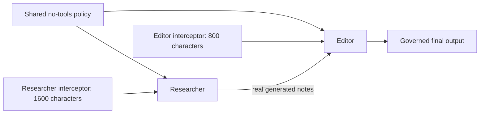
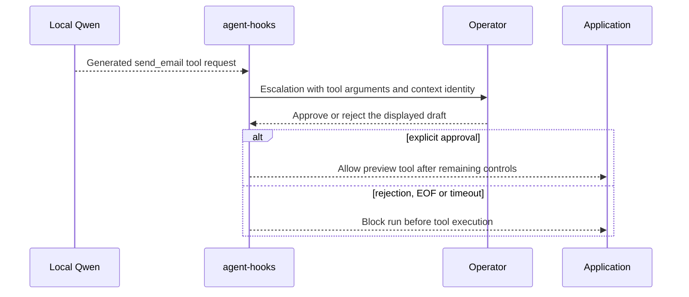

# CrewAI hook examples using agent-hooks

These are complete, standalone replacements for CrewAI's official
[execution-hook](https://docs.crewai.com/v1.15.23/en/learn/execution-hooks),
[LLM-hook](https://docs.crewai.com/v1.15.23/en/learn/llm-hooks) and
[tool-hook](https://docs.crewai.com/v1.15.23/en/learn/tool-hooks) scenarios.
They keep native `Agent`, `Task`, tools and `Crew` setup, but use SDK policies
instead of registering native `@on` functions. The scenarios are credited to
CrewAI; these files supply the complete application and SDK integration.
The broad Crew/Flow walkthrough is not required to learn the adapter.

Each file includes its local model configuration using CrewAI's built-in
`OpenAICompletion`, policies and execution call. There are no hidden
agent/crew factories, custom model wrappers or imports from other examples.

The examples print just their real answer or blocked status, with untrusted text
escaped for terminal safety. Model digest/version probes and detailed JSON
receipts live in [the test recorder](../../tests/record_example.py), not in the
examples.

| Complete example | What it demonstrates |
|---|---|
| [llm_hooks.py](llm_hooks.py) | Replace the native response-sanitization hook with an SDK transform |
| [tool_hooks.py](tool_hooks.py) | Replace the native destructive-tool hook with an SDK denial |
| [human_approval.py](human_approval.py) | Replace the native pre-tool approval gate with an SDK approval resolver |
| [multi_agent.py](multi_agent.py) | Replace role-name filtering with trusted per-agent policy bindings |

## Minimal customer change

Keep your existing native workflow. Replace the native hook function with a
small `intercept(context) -> Verdict` policy, import `Backend`, `RunRequest`
and `with_agent_hooks` from `agent_hooks_adapters`, and change the execution
call. Given an existing `crew`, input dictionary and policy, the migration is:

```diff
- result = crew.kickoff(inputs=inputs)
+ governed = with_agent_hooks(
+     backend=Backend.CREWAI, runtime=crew, interceptors=[policy]
+ )
+ result = governed.run(RunRequest(inputs=inputs))
- print(result.raw)
+ print(result.output)
```

This is a migration diff, not another incomplete example; the four linked files
contain all runnable code. Do not register the old native hook and its replacement
policy together. The wrapper returns a governed runner; it does not modify the
crew so that a later direct `crew.kickoff()` becomes governed. `create_adapter`
remains a compatible alias.

The supported alpha profile still requires synchronous sequential execution,
`respect_context_window=False`, and enough iterations for the task (`max_iter=3`
in these examples). Unsupported native features are rejected, not silently
disabled; see [coverage](../../docs/coverage.md).

## Run the complete examples

Run from the **repository root**, after `uv sync --group dev`.
Use an already installed/running Ollama with `qwen2.5:latest`:

```bash
curl --fail http://localhost:11434/api/tags
uv run --no-sync python -m examples.crewai.llm_hooks
uv run --no-sync python -m examples.crewai.tool_hooks
uv run --no-sync python -m examples.crewai.human_approval
uv run --no-sync python -m examples.crewai.multi_agent
```

You can also run any file directly, for example:

```bash
uv run --no-sync python examples/crewai/llm_hooks.py
```

A copied file can run outside this repository using the same provisioned Python
environment. It still requires the installed adapter, CrewAI and its native
OpenAI-provider dependencies, and the already running local model; "standalone" does not
mean dependency-free.

No downloads or remote fallback occur. The endpoint is deliberately fixed to
`http://localhost:11434/v1`; these examples no longer read `LOCAL_MODEL_BASE_URL`.
`LOCAL_MODEL` selects another installed model, with an omitted tag becoming
`:latest`. Native model requests use a 60-second timeout, a 256-token output limit,
temperature zero, and no SDK retries. Telemetry/tracing is disabled.
Agents explicitly disable automatic context summarization and use `max_iter=3`.
The adapter reserves the last iteration to prevent an unhooked forced-final
model call; these short tasks ordinarily finish after one governed request.

The governance portion is `with_agent_hooks(backend=Backend.CREWAI, runtime=crew, ...)`
followed by `adapter.run(RunRequest(...))`. Successful runs expose `result.output`
and actual SDK audit records. Denials raise the common `AdapterBlocked` error.
The multi-agent example assigns policies to the stable application labels
`researcher` and `editor`, with an explicit trusted mapping to the actual agents.
Native SDK context IDs remain unchanged.

There is no custom `BaseLLM` subclass or model-client wrapper. `OpenAICompletion`
is the same built-in provider that CrewAI's `LLM` factory selects for this
OpenAI-compatible endpoint. Calling it directly keeps its provider-specific
options fully typed with pinned CrewAI 1.15.23.

These are one-shot CLI demonstrations. Native HTTP clients and message handling
belong to CrewAI and the OpenAI SDK; the examples do not override their proxy,
redirect or cleanup behavior, or implement a separate HTTP-request budget.
They are not a hardened transport layer for an untrusted model server.

## What to expect

- **LLM hooks:** the local model writes a sentence containing the fictional
  identifier `000-00-0000`; a `post_model_call` transform redacts SSN-shaped
  identifiers before the response reaches the agent. The file checks that real
  sanitization happened. This regex demonstrates the hook, not complete PII/DLP
  protection.
- **Tool hooks:** the real model requests `delete_file`; a `pre_tool_call` policy
  blocks it. The demonstration tool never reads or deletes a file, and raises if
  its body is unexpectedly reached. The example requires the actual tool-policy
  denial rather than treating any unrelated failure as success.
- **Human approval:** the SDK emits a liftable deny before `send_email`. The
  resolver displays the model-generated message with control characters escaped.
  Type `approve` within 15 seconds to allow the preview tool. Any other input,
  EOF, or timeout rejects it before execution. SDK
  callback timeout is 20 seconds; total emission timeout is 30 seconds.
  Despite its native-example name, the demonstration `send_email` tool only
  prints an approved preview: no email is sent.
- **Multiple agents:** the researcher produces notes; the editor consumes them.
  The researcher has a 1,600-character response limit and the editor has an
  800-character limit, represented by **different interceptor instances**. The
  example checks that each policy saw only its bound agent ID.





This console is a learning example, **not a production approval service**. It
does not authenticate an operator, persist a review ticket, or make the generated
text trustworthy. Approval binds to the displayed tool request's SDK context identity. A
production resolver should authenticate and authorize its approver.

## Deliberate differences from native hooks

Native `@on` hooks can fail open on ordinary callback exceptions. A blocked native
tool call can also let the agent continue. The adapter instead fails closed and
makes a denial sticky for the entire crew run. SDK approval cannot bypass another
policy. Agent selection uses actual host-owned objects, not a model-controlled
name or native role-string filter.

These examples govern crew/model/tool boundaries, not arbitrary Flow steps or
direct LLM/tool calls outside the returned runner.

## Reproduce the evidence

```bash
LOCAL_MODEL_REQUIRED=1 uv run --no-sync pytest -m e2e
```

The e2e suite runs the actual entry-point code both as modules and as individual
files copied outside the repository, including approval, rejection and EOF.
It requires real redaction, a real model-requested denied tool, and one approved
preview or no preview after rejection. Native structured tool-call responses can
bypass the textual post-model hook; tool authorization uses `pre_tool_call`,
not a post-model filter.
The test recorder observes the original adapter execution and real HTTP
requests; it does not replace model responses or governance decisions. Copied
files run in Python's isolated mode without adding the repository to
`sys.path`, so they cannot rely on its working directory or `PYTHONPATH`.

The suite pipes explicit decisions into the approval example and labels those
receipts `piped-test-input`. That tests the seam with a real model; it is **not
evidence that a person approved the run**. The fixture endpoint must match the
examples' fixed endpoint.

The recorder emits `RESULT_JSON` receipts containing actual output (or `null`
when blocked), SDK decisions, model name, installed artifact digest, Ollama
runtime version, observed request count, temperature and token limit. It checks
that the model artifact and runtime did not change during the run. Temperature
zero does not guarantee repeatable text. Assertions concern governance,
native model settings, request counts, and isolation, not exact wording.

To retain freshly generated receipts:

```bash
LOCAL_MODEL_REQUIRED=1 EXAMPLE_CAPTURE_DIR=docs/example-runs \
  uv run --no-sync pytest -m e2e
```

Module receipts use `llm-redacted`, `tool-blocked`, `human-approved`,
`human-rejected`, `human-eof` and `multi-agent`; copied-file receipts add a
`-standalone` suffix. Existing `allowed`/`blocked` receipts are historical evidence
from the previous generic demos, not evidence for these replacements.

The tool-blocking example verifies denial before the tool body executes, not
non-generation or absence from the model server's internal state. All examples
use harmless synthetic tasks and have no external tool effects.
